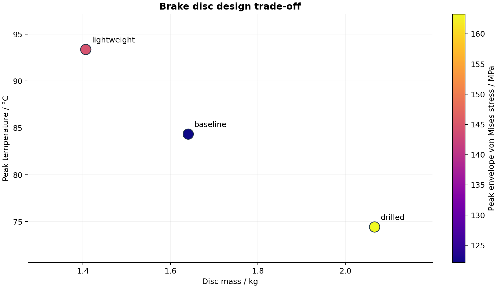
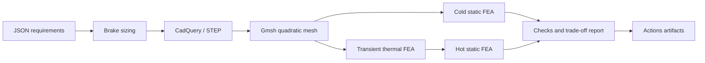

# Brake Disc Design Pipeline

[](https://github.com/octahedralnuke/brake-disc-design-pipeline/actions/workflows/design.yml)


A working engineering automation project that turns kart braking requirements into parameterized disc models, finite element analyses and a checked design comparison.

**Python · CadQuery · Gmsh · CalculiX · GitHub Actions**



## Features

- Calculates brake torque, pad normal forces, stopping time, braking energy and analytical mean temperature rise.
- Builds solid and drilled disc variants in CadQuery; exports STEP solids, DXF profiles and dimensioned SVG drawings.
- Imports and partitions STEP geometry in Gmsh, selects physical surfaces and creates conforming quadratic tetrahedral meshes.
- Runs real CalculiX analyses: cold static torque, transient braking/cooling, and a hot static thermal-stress envelope.
- Checks yield safety factor, peak temperature, reaction torque, CAD/mesh volume and thermal energy balance.
- Produces an offline HTML report, CSV/JSON results, temperature/stress plots, ParaView VTU fields and complete solver decks/logs.
- Repeats the workflow on pushes and pull requests. Solver failures and failed criteria reject the CI job.



## Quick start

The tested environment uses Linux, Python 3.11 and CalculiX 2.21. Python 3.12 is supported by the package configuration. On Windows, use WSL2/Ubuntu or the container option. Run commands from the repository root.

Install system dependencies on Ubuntu/Debian:

```bash
sudo apt-get update
sudo apt-get install -y calculix-ccx libglu1-mesa libgl1 libxrender1 libxext6 python3-venv
```

Create an environment with Python 3.11 or 3.12:

```bash
python3 -m venv .venv
source .venv/bin/activate
python -m pip install -r requirements.lock
python -m pip install --no-deps -e .
brakedisc doctor
brakedisc run
```

Open **`results/report.html`** in a browser; no server is required. Real solver runs take several minutes. Repeat with `brakedisc run --overwrite`; only a marked, previously generated run directory can be replaced.

If your system Python is newer than 3.12, use [uv](https://docs.astral.sh/uv/getting-started/installation/) to obtain an isolated compatible runtime:

```bash
uv venv --python 3.11 .venv
source .venv/bin/activate
uv pip sync requirements.lock
uv pip install --no-deps -e .
brakedisc run
```

For a custom solver location, set `CCX` to its executable path.

### Container option

```bash
docker build -t brake-disc-design .
mkdir -p results
docker run --rm -v "$PWD/results:/app/results" brake-disc-design
```

The Dockerfile provides an alternative dependency setup. CI validates the native Ubuntu installation path.

## Commands

| Command | Purpose |
|---|---|
| `brakedisc doctor` | Check imports and locate CalculiX |
| `brakedisc size` | Print analytical braking requirements |
| `brakedisc run` | Run all configured variants and enforce limits |
| `brakedisc run --variant baseline --out results-baseline` | Run one variant |
| `brakedisc run --mesh-mm 5 --out results-mesh5` | Change the mesh target |
| `brakedisc verify` | Run four analytical solver benchmarks |
| `brakedisc converge` | Compare the baseline at 6, 5 and 4 mm mesh targets |
| `brakedisc check results/summary.json` | Re-evaluate a saved study |
| `pytest -q` | Run unit and real-solver integration tests |

Exit **0** means success, **2** means a completed study was rejected, and **1** means an input, dependency or execution error. A solver error within a multi-variant study is saved in the summary and rejects that study.

### Demonstrate rejection

Recheck a passing study against an impossible safety requirement:

```bash
python scripts/assert_gate_failure.py results/summary.json
```

Or run the supplied **2 mm disc**, whose geometry is intentionally inadequate for this load case:

```bash
brakedisc run --config configs/rejected.json --out results-rejected
```

The latter runs actual CAD and FEA and is expected to exit with status 2. Its report identifies the failed criteria. This configuration is excluded from the normal passing sweep.

## Default study

| Input | Value |
|---|---:|
| Kart + driver mass | 180 kg |
| Initial speed | 70 km/h |
| Constant deceleration | 7 m/s² |
| Wheel rolling radius | 0.14 m |
| Brake share / discs | 100% / 1 |
| Pad friction coefficient | 0.40 |
| Allocated heat entering disc | 90% |
| Initial / ambient temperature | 25 °C |
| Assumed convection coefficient | 30 W/(m²·K) |
| Cooling after stop | 8 s |

These give **176.4 N·m**, **5,400 N total normal force across both pads**, a **2.778 s** stop and **30.625 kJ** of disc heat. Uniform annular pressure gives an effective friction radius of 81.667 mm.

All variants have a 200 mm outside diameter, 40 mm bore, six Ø8 mm bolt holes on a 70 mm PCD and a swept annulus from R60 to R100 mm. Baseline thickness is 7 mm; lightweight thickness is 6 mm; the drilled disc is 9 mm thick with twelve Ø8 mm holes on a 160 mm PCD.

<!-- VERIFIED_RESULTS_START -->
See `examples/study/summary.json` for verified results generated from the supplied configuration.
<!-- VERIFIED_RESULTS_END -->

Material properties are explicitly assumed **generic steel** values, not certified rotor-alloy data. See [configuration](configs/kart.json) and [methodology](docs/methodology.md).

## Verification and interpretation

- Four real-solver benchmarks check uniaxial stress, free thermal expansion, uniform adiabatic heating and Fourier conduction.
- Conservation checks cover reaction torque, integrated thermal energy and CAD/mesh volume.
- A separate three-mesh study compares temperature rise, swept-region stress and displacement. The raw global stress maximum is also reported. [Verification evidence](docs/verification.md)
- Invalid geometry, incomplete output, nonfinite data and solver failures cannot silently pass.

Safety factor is assumed yield strength divided by the maximum integration-point von Mises stress across the cold/hot envelope, including the idealized mount. Default limits are SF ≥ 1.5 and temperature ≤ 250 °C, plus numerical consistency criteria. These are project screening settings.

Heating is averaged around the swept annulus; bolt-hole surfaces form an idealized rigid mount. Local moving pad contact, brake fade, repeated-stop fatigue, wear, fluid flow and bolt flexibility are outside the model. Drawings contain nominal dimensions without assigned manufacturing tolerances. Results support educational design screening.

## Outputs and repository map

```text
configs/                 Requirements, material, variants and limits
src/brakedisc/           Sizing, CAD, mesh, solver, reports and CLI
tests/                   Physics, validation, parser and integration tests
docs/                    Methodology, verification and evaluation guide
examples/study/          Committed results from the verified sweep
examples/convergence/    Committed mesh-sensitivity results
.github/workflows/       Continuous engineering verification
results/                Regenerated complete outputs (git-ignored)
```

Each variant produces STEP, DXF and SVG geometry, `.msh`/`.npz` meshes, cold/thermal/hot `.inp` decks and solver outputs, cold/hot `.vtu` fields, plots and `thermal_history.csv`. The study adds `report.html`, JSON/CSV comparisons, trade-off plots, resolved inputs and SHA-256 artifact hashes. Native `.msh` coordinates are in **mm**; solver, NumPy and VTU coordinates are in **m**.

Large regenerated solver outputs are downloadable CI artifacts. From [Actions](https://github.com/octahedralnuke/brake-disc-design-pipeline/actions), download `brake-disc-study`, extract it and open the report.

For a live demonstration, follow the [evaluation guide](docs/evaluation-guide.md). [Submission notes](docs/submission-notes.md) map project claims to implementation files.

## References

- [CadQuery CAD export documentation](https://cadquery.readthedocs.io/en/latest/importexport.html)
- [Gmsh manual and API](https://gmsh.info/doc/texinfo/)
- [CalculiX solver and official manuals](https://www.dhondt.de/)
- [GitHub Actions artifacts](https://docs.github.com/en/actions/tutorials/store-and-share-data)

Source is MIT licensed. External tools retain their own licences; see [third-party notices](THIRD_PARTY.md).
