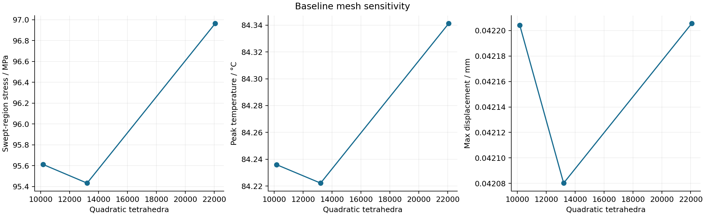

# Numerical verification

## Analytical benchmarks

Run `brakedisc verify` to execute the four benchmarks with the installed CalculiX binary. They are also part of the integration tests. Captured benchmark results are in `examples/verification/verification.json`.

| Check | Closed-form target | Relative error in reference run | Acceptance |
|---|---|---:|---:|
| Uniaxial stress patch | `sigma_x = E epsilon`, other stresses zero | 1.40 × 10⁻¹⁶ | < 10⁻⁵ |
| Free thermal expansion | `u = alpha DeltaT x`, negligible stress | 7.31 × 10⁻¹⁵ | < 10⁻⁵; stress < 100 Pa |
| Uniform adiabatic heating | `DeltaT = qv t / (rho cp)` | 2.08 × 10⁻⁶ | < 10⁻⁴ |
| Fourier conduction patch | `q = -k grad(T)` | 0 at printed precision | < 10⁻⁵ |

The stress and conduction patches impose affine fields on a quadratic reference tetrahedron and check integration-point results. The expansion case uses minimal rigid-body restraints. Heating uses consistent volumetric-source nodal integrals, including quadratic corner weights. These checks exercise actual solver decks, element ordering, material cards, units, output parsing and thermal-to-mechanical strain.

These small verification problems do not establish experimental accuracy for a real brake disc.

## Thermal solver comparison

The revised 9 mm drilled disc was also solved with both direct SPOOLES and `ITERATIVE SCALING`, using identical mesh, material, loads and time increments. Across **100 snapshots × 47,848 nodes**, the maximum printed temperature difference was **0.00001 °C**, below the 0.001 °C comparison tolerance. See [the recorded comparison](../examples/verification/direct-vs-iterative.json). The iterative solver is used by the pipeline for the linear thermal system; structural analyses retain the default direct solver.

## Test coverage

The reference test suite has **41 passing tests**. It covers hand-calculated braking loads, energy scaling, heat partition, CAD feature validation, quadratic integration, von Mises stress states, parser corruption, missing/duplicate nodes, unavailable solvers, safe output replacement, failed acceptance criteria, real drilled-disc CAD/mesh selection and the analytical solver benchmarks. Ruff and Python byte-compilation checks also pass.

## Mesh sensitivity

The baseline is analysed at target mesh sizes of 6, 5 and 4 mm. The two finest meshes must differ by less than 2% in peak temperature **rise**, 5% in swept-region hot stress and 5% in maximum displacement. Every mesh must also pass the normal study checks.

Global peak stress is retained in the table and remains the design gate's stress metric. The swept-region metric separately avoids confusing sensitivity of the idealized mount with the friction-ring result. This is a sensitivity study, not a formal error bound or proof of convergence to a physical solution.

<!-- CONVERGENCE_RESULTS_START -->
| Target / mm | Elements | Peak / °C | Swept stress / MPa | Global stress / MPa | Displacement / mm |
|---:|---:|---:|---:|---:|---:|
| 6 | 10171 | 84.236 | 95.610 | 122.852 | 0.042204 |
| 5 | 13208 | 84.222 | 95.432 | 121.857 | 0.042080 |
| 4 | 22076 | 84.341 | 96.964 | 122.162 | 0.042206 |

Two finest meshes: swept-stress change **1.580%**, temperature-rise change **0.201%**, displacement change **0.297%**. Result: **PASS**.

<!-- CONVERGENCE_RESULTS_END -->

## Conservation and completeness

- CAD volume is independently checked against the analytical annulus/hole volume.
- Integrated curved-mesh volume must match CAD within 1%.
- The mount's reaction moment must match applied torque within 1%.
- Maximum thermal energy residual must remain below 2% of analytical continuous-time stop heat.
- All nodes, all stress integration points, positive sampled Jacobians and the thermal final time are checked.
- Solver return status, completion marker and error messages are checked before accepting output.

The source is not renormalized to conceal time-integration error. The energy CSV retains input heat, internal energy, convection and residual terms for independent inspection.

## Rejection evidence

`configs/rejected.json` makes the otherwise identical disc 2 mm thick. This is analysed separately from the normal passing variants. Its committed numeric results show the actual failed criteria. The CI demonstration also checks that an impossible safety-factor requirement returns the documented rejection status.

## Reference environment

Python 3.11.14, CadQuery 2.6.1, Gmsh 4.14.1, CalculiX 2.21, NumPy 2.2.6, Matplotlib 3.10.3 and meshio 5.3.5 on Linux. Exact transitive dependencies are pinned with hashes in `requirements.lock`.

Reference rejected case: 225.8 °C, 439.4 MPa, SF 0.57. Failed checks: safety_factor. See `examples/rejected/summary.json`.

The original 7 mm drilled design reached 198.2 MPa (SF 1.26) and was rejected. Its real solver outputs are preserved in `examples/rejected-drilled/`. Increasing that variant to 9 mm produces the passing result in the main comparison, with unchanged material, loads and acceptance criteria.
